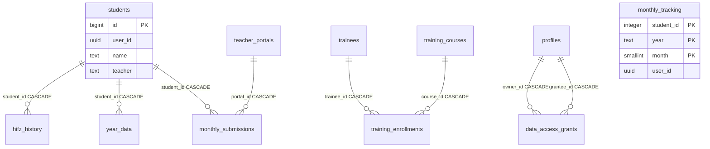

# قاعدة بيانات مركز إنماء الأهلي الخيري — النسخة التي تعمل بدون إنترنت

> **في هذه النسخة لا يوجد Supabase ولا خادم.** نفس الجداول الـ 22 وأعمدتها الموصوفة أدناه
> (عدا جداول المستخدمين والأذونات) تُحفظ كملفات JSON داخل **مجلد قاعدة البيانات** الذي يختاره
> المستخدم في ذاكرة الهاتف أو على بطاقة SD. المخطط السحابي أدناه بقي مرجعاً: الأعمدة والقيم
> الافتراضية والقيود الفريدة والحذف المتسلسل مطبَّقة محلياً بنفس السلوك (`src/offline/schema.ts`)،
> وهو أيضاً ما تقرؤه ميزة «النقل من النسخة السحابية» لمرة واحدة.

## صيغة مجلد قاعدة البيانات (المحلية)

| الملف                                  | المحتوى                                                                                                                                           |
| -------------------------------------- | ------------------------------------------------------------------------------------------------------------------------------------------------- |
| `mrkzy-db.json`                        | ملف التعريف: `app` = `mrkzy-net`، `format` (إصدار الصيغة = 1)، `sequences` (آخر معرّف رقمي لكل جدول مثل `students`)، `counts`، `last_backup_date` |
| `<الجدول>.json`                        | ملف لكل جدول: `{"app","format","table","saved_at","count","rows":[ … ]}` — صف في كل سطر لسهولة القراءة                                            |
| `<الجدول>.json.tmp`                    | ملف مؤقت أثناء الكتابة الآمنة (يُستعاد منه تلقائياً إن انقطعت الكتابة قبل إعادة التسمية)                                                          |
| `<الجدول>.corrupt-<وقت>.json`          | نسخة محفوظة من ملف تالف تعذّرت قراءته                                                                                                             |
| `backups/mrkzy-backup-YYYY-MM-DD.json` | نسخة يومية تلقائية لكل الجداول (يُحتفظ بآخر 14)                                                                                                   |
| `backups/mrkzy-manual-*.json`          | نسخ يدوية من شاشة «قاعدة البيانات»                                                                                                                |
| `backups/mrkzy-before-*.json`          | نسخ أمان تُحفظ تلقائياً قبل أي استعادة أو نقل من السحابة                                                                                          |
| `media/<العام>/<ملف>`                  | الصور والفيديوهات (جدول `media` يحفظ المسار النسبي داخل `media/`)                                                                                 |
| `media/.nomedia`                       | ملف فارغ يُنشأ على أندرويد مع أول صورة/فيديو حتى لا تظهر الوسائط في «معرض الصور» (فهي نسخ مكررة قد تُحذف من هناك خطأً)                            |

الجداول المحلية: `students`, `year_data`, `hifz_history`, `monthly_tracking`, `teachers`,
`teacher_bonuses`, `teacher_portals`, `monthly_submissions`, `awards`, `certificates`, `donors`,
`ceremony_expenses`, `student_competitions`, `exam_questions`, `media`, `trainees`,
`training_courses`, `training_enrollments`, `user_settings`, `profiles` — إضافة إلى جدول محلي
`app_settings` (مفتاح/قيمة: العام النشط، مرشّحات الجدول، الحالات، الأعمدة المخصّصة).
لا توجد محلياً: `user_roles`, `data_access_grants` (مستخدم واحد على الجهاز).

كل الصفوف تحمل `user_id = 00000000-0000-4000-8000-000000000001` (المستخدم المحلي الثابت).

السلوك المطابق لـ PostgreSQL (مُختبَر في `npm run test:db`):

- معرّف `students.id` تسلسلي لا يُعاد استخدامه بعد الحذف (مثل BIGSERIAL)، وبقية الجداول `uuid`.
- القيم الافتراضية و`created_at`/`updated_at` تُملأ تلقائياً.
- القيود الفريدة ترجع خطأ `23505` (`duplicate key value violates unique constraint …`)، ومنها القيد
  الجزئي للتقرير اليدوي (`portal_id IS NULL`).
- الحذف المتسلسل: حذف طالب/ة يحذف `year_data` و`hifz_history` و`monthly_submissions` — و
  `monthly_tracking` أيضاً (في السحابة كانت تبقى يتيمة بلا FK)؛ حذف بوابة يحذف ترسيلاتها؛ حذف دورة
  أو متدرب/ة يحذف التسجيلات.
- الدالتان `open_teacher_portal` و`submit_teacher_monthly` منفذتان محلياً بنفس الفحوصات ورسائل الخطأ.

عرض الوسائط على أندرويد: `getFileUri`/`getFileUris` (دفعة واحدة لمعرض الوسائط) تعيد روابط `content://`
تتحول إلى `https://localhost/_capacitor_content_/…`، ويخدمها `MediaRangeWebViewClient.java` مع دعم طلبات
النطاق (HTTP Range ← 206) حتى يعمل التقديم في الفيديو ومقاطع الهاتف التي فهرسها في نهاية الملف — خادم
Capacitor الافتراضي لا يقفز إلى بداية النطاق المطلوب.

---

# مرجع: مخطط Supabase الأصلي

## الملفات المرجعية

| الملف                                | الدور                                                   |
| ------------------------------------ | ------------------------------------------------------- |
| `supabase/migrations/*.sql`          | مصدر الحقيقة لإنشاء المخطط من الصفر                     |
| `src/integrations/supabase/types.ts` | أنواع العميل (`Database["public"]["Tables"]`)           |
| `supabase/drop-all-tables.sql`       | حذف كل جداول `public` الـ 22 ودوالها ثم أي جدول متبقٍ   |
| `scripts/test-sql.mjs`               | اختبارات المخطط (117 اختباراً) على PGlite               |
| `docs/روابط-المعلمين-دليل.md`        | دليل بوابة المعلم/ة والوارد والتقرير اليدوي             |
| `src/offline/schema.ts`              | مخطط قاعدة بيانات المجلد المحلية (نفس الجداول والأعمدة) |
| `src/utils/storage.ts`               | طبقة CRUD السحابية لجداول القرآن/المالية/المتابعة       |
| `supabase/config.toml`               | `project_id = hzpvtmfgvddjkuzonict`                     |

### إعادة الإنشاء من الصفر

1. شغّل `supabase/drop-all-tables.sql` في **SQL Editor**.
2. طبّق الـ migrations بالترتيب الزمني لأسماء الملفات (أو `supabase db push` / ربط Git).
3. إن تغيّر المخطط: أعد توليد الأنواع:
   ```sh
   npx supabase gen types typescript --project-id hzpvtmfgvddjkuzonict > src/integrations/supabase/types.ts
   ```

---

## الجداول الـ 22

| #   | الجدول                 | المجال         | المفتاح الأساسي                                        | مصدر الإنشاء                                          |
| --- | ---------------------- | -------------- | ------------------------------------------------------ | ----------------------------------------------------- |
| 1   | `students`             | قرآن           | `id` BIGSERIAL                                         | `20260325213517_…`                                    |
| 2   | `hifz_history`         | قرآن           | `id` UUID                                              | `20260325213517_…`                                    |
| 3   | `year_data`            | قرآن           | `id` UUID                                              | `20260325213517_…`                                    |
| 4   | `user_settings`        | إعدادات        | `id` UUID                                              | `20260325213517_…`                                    |
| 5   | `media`                | وسائط          | `id` UUID                                              | `20260406155120_…`                                    |
| 6   | `teacher_bonuses`      | معلمون         | `id` UUID                                              | `20260509140332_…`                                    |
| 7   | `teachers`             | معلمون         | `id` UUID                                              | `20260510142231_…`                                    |
| 8   | `awards`               | تكريم          | `id` UUID                                              | `20260720141412_…`                                    |
| 9   | `donors`               | مالية          | `id` UUID                                              | `20260728090414_…`                                    |
| 10  | `ceremony_expenses`    | مالية          | `id` UUID                                              | `20260728090414_…`                                    |
| 11  | `certificates`         | تكريم          | `id` UUID                                              | `20260728090414_…`                                    |
| 12  | `student_competitions` | مسابقات        | `id` UUID                                              | `20260911120000_students_hub_additions.sql`           |
| 13  | `exam_questions`       | اختبارات       | `id` UUID                                              | `20260911120000_students_hub_additions.sql`           |
| 14  | `trainees`             | تدريب          | `id` UUID                                              | `20260913120000_training_department.sql`              |
| 15  | `training_courses`     | تدريب          | `id` UUID                                              | `20260913120000_training_department.sql`              |
| 16  | `training_enrollments` | تدريب          | `id` UUID                                              | `20260913120000_training_department.sql`              |
| 17  | `monthly_tracking`     | متابعة شهرية   | مركّب `(student_id, year, month)` — **بدون عمود `id`** | `20261011120000_monthly_tracking.sql`                 |
| 18  | `profiles`             | مستخدمون       | `id` UUID = `auth.users.id`                            | `20261011130000_user_management_and_data_sharing.sql` |
| 19  | `user_roles`           | مستخدمون       | `id` UUID                                              | `20261011130000_user_management_and_data_sharing.sql` |
| 20  | `data_access_grants`   | مستخدمون       | `id` UUID                                              | `20261011130000_user_management_and_data_sharing.sql` |
| 21  | `teacher_portals`      | روابط المعلمين | `id` UUID                                              | `20261011140000_teacher_portal_and_submissions.sql`   |
| 22  | `monthly_submissions`  | وارد المعلمين  | `id` UUID                                              | `20261011140000_teacher_portal_and_submissions.sql`   |

كل الجداول عليها **RLS**:

- جداول البيانات (1–17): سياسات `auth.uid() = user_id` لـ SELECT/INSERT/UPDATE/DELETE (ما عدا `user_settings` بلا سياسة DELETE صريحة)، **وزيادةً عليها** سياسة `Shared read through access grants` للقراءة عبر `can_read_user_data(user_id)`.
- `profiles` / `user_roles` / `data_access_grants`: سياسات مخصّصة — الملف الشخصي يقرأه الجميع ويعدّله صاحبه؛ الأدوار يقرأها الجميع ولا يكتبها إلا المسؤول؛ الأذونات يديرها صاحب البيانات فقط ولا يمنح أحدٌ نفسه إذناً.
- `teacher_portals` / `monthly_submissions`: المالك يديرها، ودور `anon` يصل إليها **عبر الدالتين** `open_teacher_portal` و`submit_teacher_monthly` فقط (بلا سياسات مباشرة لـ`anon`).

---

## العلاقات



مفاتيح أجنبية مصرَّح بها في الـ migrations (داخل `public` أو إلى `auth.users`):

| الجدول                 | العمود       | يشير إلى               | ON DELETE                        |
| ---------------------- | ------------ | ---------------------- | -------------------------------- |
| `students`             | `user_id`    | `auth.users(id)`       | CASCADE                          |
| `hifz_history`         | `user_id`    | `auth.users(id)`       | CASCADE                          |
| `hifz_history`         | `student_id` | `students(id)`         | CASCADE                          |
| `year_data`            | `user_id`    | `auth.users(id)`       | CASCADE                          |
| `year_data`            | `student_id` | `students(id)`         | CASCADE                          |
| `user_settings`        | `user_id`    | `auth.users(id)`       | CASCADE                          |
| `awards`               | `user_id`    | `auth.users(id)`       | CASCADE                          |
| `training_enrollments` | `trainee_id` | `trainees(id)`         | CASCADE                          |
| `training_enrollments` | `course_id`  | `training_courses(id)` | CASCADE                          |
| `profiles`             | `id`         | `auth.users(id)`       | CASCADE                          |
| `user_roles`           | `user_id`    | `auth.users(id)`       | CASCADE                          |
| `data_access_grants`   | `owner_id`   | `profiles(id)`         | CASCADE                          |
| `data_access_grants`   | `grantee_id` | `profiles(id)`         | CASCADE                          |
| `teacher_portals`      | `user_id`    | `auth.users(id)`       | CASCADE                          |
| `monthly_submissions`  | `user_id`    | `auth.users(id)`       | CASCADE                          |
| `monthly_submissions`  | `portal_id`  | `teacher_portals(id)`  | CASCADE (فارغ في الإدخال اليدوي) |
| `monthly_submissions`  | `student_id` | `students(id)`         | CASCADE                          |

`types.ts` يعكس علاقات `public` فقط (لا يدرج `auth.users`): `hifz_history` → `students`، `year_data` → `students`، `training_enrollments` → `trainees` و`training_courses`.

**غير مربوط بـ FK رغم الارتباط المنطقي:**

- `monthly_tracking.student_id` → `students.id` (و`student_id` هنا `integer` بينما `students.id` هو `bigint`).
- `user_id` في معظم الجداول المتأخرة (`media`, `teachers`, `teacher_bonuses`, `donors`, `ceremony_expenses`, `certificates`, `student_competitions`, `exam_questions`, `trainees`, `training_courses`, `training_enrollments`, `monthly_tracking`) بلا `REFERENCES auth.users`. الحماية تتم عبر RLS.

---

## تفاصيل الأعمدة

الرموز: `PK` مفتاح أساسي، `U` فريد، `NN` NOT NULL، `d=` قيمة افتراضية.

### 1. `students`

سجل الطالبات/الطلاب عبر كل الأعوام.

| العمود                   | SQL                      | types.ts         | ملاحظات                                    |
| ------------------------ | ------------------------ | ---------------- | ------------------------------------------ |
| `id`                     | `BIGSERIAL PK`           | `number`         |                                            |
| `user_id`                | `UUID NN` → `auth.users` | `string`         |                                            |
| `name`                   | `TEXT NN d=''`           | `string`         |                                            |
| `teacher`                | `TEXT NN d=''`           | `string`         | اسم المعلمة/المعلم كنص، ليس FK             |
| `gender`                 | `TEXT`                   | `string \| null` | `ذكر` / `أنثى` (`GENDER_OPTIONS`)          |
| `hijri_join_date`        | `TEXT`                   | `string \| null` | تاريخ الالتحاق الهجري                      |
| `initial_hifz`           | `TEXT`                   | `string \| null` | الحفظ عند الالتحاق                         |
| `first_competition_year` | `TEXT`                   | `string \| null` | أول عام مشاركة في مسابقة                   |
| `status`                 | `TEXT`                   | `string \| null` | من قائمة الحالات المُدارة في الإعدادات     |
| `school_grade`           | `TEXT`                   | `string \| null` | الصف الدراسي (`src/utils/schoolGrades.ts`) |
| `guardian_phone`         | `TEXT`                   | `string \| null` | هاتف ولي الأمر                             |
| `student_phone`          | `TEXT`                   | `string \| null` | هاتف الطالب/ة                              |
| `custom_fields`          | `JSONB NN d='{}'`        | `Json`           | قيم الأعمدة المخصّصة `{columnId: value}`   |
| `notes`                  | `TEXT`                   | `string \| null` | ملاحظات حرة                                |
| `created_at`             | `timestamptz NN d=now()` | `string`         |                                            |
| `updated_at`             | `timestamptz NN d=now()` | `string`         | trigger                                    |

الأعمدة العشرة بين `gender` و`notes` أُضيفت في `20261011150000_add_student_profile_fields.sql`، مع فهرسَي `idx_students_school_grade(user_id, school_grade)` و`idx_students_gender(user_id, gender)`.

### 2. `hifz_history`

قيمة الحفظ الأساسي لكل عام (`year_key` مثل `h1447`). **لا يوجد `updated_at`.** `UNIQUE(student_id, year_key)`.

| العمود       | SQL                           | types.ts |
| ------------ | ----------------------------- | -------- |
| `id`         | `UUID PK d=gen_random_uuid()` | `string` |
| `user_id`    | `UUID NN` → `auth.users`      | `string` |
| `student_id` | `BIGINT NN` → `students`      | `number` |
| `year_key`   | `TEXT NN`                     | `string` |
| `value`      | `TEXT NN d='0'`               | `string` |
| `created_at` | `timestamptz NN d=now()`      | `string` |

### 3. `year_data`

نتائج العام الدراسي (مسابقة سنوية، درجات، جائزة، ترتيب). `UNIQUE(student_id, year)`. عمود `teacher` أُضيف لاحقاً في `20260406160125_…`.

| العمود                      | SQL                      | types.ts |
| --------------------------- | ------------------------ | -------- |
| `id`                        | `UUID PK`                | `string` |
| `user_id`                   | `UUID NN` → `auth.users` | `string` |
| `student_id`                | `BIGINT NN` → `students` | `number` |
| `year`                      | `TEXT NN`                | `string` |
| `base_hifz`                 | `TEXT NN d='0'`          | `string` |
| `total_hifz`                | `TEXT NN d='0'`          | `string` |
| `parts`                     | `TEXT NN d=''`           | `string` |
| `annual`                    | `TEXT NN d=''`           | `string` |
| `recitation`                | `TEXT NN d=''`           | `string` |
| `memorization`              | `TEXT NN d=''`           | `string` |
| `total`                     | `TEXT NN d='0'`          | `string` |
| `grade`                     | `TEXT NN d=''`           | `string` |
| `prize`                     | `TEXT NN d='0'`          | `string` |
| `status_prize`              | `TEXT NN d=''`           | `string` |
| `rank`                      | `TEXT NN d='-'`          | `string` |
| `teacher`                   | `TEXT NN d=''`           | `string` |
| `created_at` / `updated_at` | `timestamptz NN`         | `string` |

### 4. `user_settings`

صف واحد لكل مستخدم (`user_id` UNIQUE). أعمدة لاحقة: `table_filters` ثم اسم المركز والتوقيعات.

| العمود                      | SQL                             | types.ts |
| --------------------------- | ------------------------------- | -------- |
| `id`                        | `UUID PK`                       | `string` |
| `user_id`                   | `UUID NN UNIQUE` → `auth.users` | `string` |
| `active_year`               | `TEXT NN d='1447'`              | `string` |
| `table_filters`             | `JSONB NN d='{}'`               | `Json`   |
| `center_name`               | `TEXT NN d=''`                  | `string` |
| `teacher_signature`         | `TEXT NN d=''`                  | `string` |
| `supervisor_signature`      | `TEXT NN d=''`                  | `string` |
| `manager_signature`         | `TEXT NN d=''`                  | `string` |
| `student_custom_columns`    | `JSONB NN d='[]'`               | `Json`   | تعريفات الأعمدة المخصّصة (`CustomColumnDef[]`) |
| `student_statuses`          | `JSONB NN d='[]'`               | `Json`   | حالات الطلاب والطالبات (`string[]`)            |
| `created_at` / `updated_at` | `timestamptz NN`                | `string` |

### 5. `media`

ميتاداتا ملفات الوسائط. الملفات نفسها في bucket التخزين `media` (خاص، مسار `{user_id}/...`). **لا يوجد `updated_at`.**

| العمود       | SQL                               | types.ts |
| ------------ | --------------------------------- | -------- |
| `id`         | `UUID PK`                         | `string` |
| `user_id`    | `UUID NN` (بلا FK)                | `string` |
| `year`       | `TEXT NN`                         | `string` |
| `month`      | `INTEGER NN CHECK (1–12)`         | `number` |
| `title`      | `TEXT NN d=''`                    | `string` |
| `file_path`  | `TEXT NN`                         | `string` |
| `file_type`  | `TEXT NN CHECK ('image','video')` | `string` |
| `file_size`  | `BIGINT NN d=0`                   | `number` |
| `created_at` | `timestamptz NN`                  | `string` |

### 6. `teacher_bonuses`

حوافز شهرية للمعلمين. `UNIQUE(user_id, teacher_name, year, month)`.

| العمود                      | SQL              | types.ts |
| --------------------------- | ---------------- | -------- |
| `id`                        | `UUID PK`        | `string` |
| `user_id`                   | `UUID NN`        | `string` |
| `teacher_name`              | `TEXT NN`        | `string` |
| `year`                      | `TEXT NN`        | `string` |
| `month`                     | `INTEGER NN`     | `number` |
| `amount`                    | `NUMERIC NN d=0` | `number` |
| `created_at` / `updated_at` | `timestamptz NN` | `string` |

### 7. `teachers`

قائمة المعلمين لكل عام. `UNIQUE(user_id, year, name)`. فهرس `idx_teachers_user_year(user_id, year)`.

| العمود                      | SQL              | types.ts |
| --------------------------- | ---------------- | -------- |
| `id`                        | `UUID PK`        | `string` |
| `user_id`                   | `UUID NN`        | `string` |
| `year`                      | `TEXT NN`        | `string` |
| `name`                      | `TEXT NN`        | `string` |
| `created_at` / `updated_at` | `timestamptz NN` | `string` |

### 8. `awards`

تكريم نقدي/عيني. قيود: `award_type ∈ {khatm_bonus, ceremony, annual, certificate}`، `award_kind ∈ {cash, in_kind}`. `recipient_type` وُسِّع في `20260811120000_expand_awards_recipient_type.sql`. `funded_by` أُضيف في `20260728090414_…`.

| العمود                      | SQL                          | types.ts         |
| --------------------------- | ---------------------------- | ---------------- |
| `id`                        | `UUID PK`                    | `string`         |
| `user_id`                   | `UUID NN` → `auth.users`     | `string`         |
| `year`                      | `TEXT NN`                    | `string`         |
| `recipient_type`            | `TEXT NN` — انظر القيم أدناه | `string`         |
| `recipient_name`            | `TEXT NN`                    | `string`         |
| `award_type`                | `TEXT NN`                    | `string`         |
| `award_kind`                | `TEXT NN d='cash'`           | `string`         |
| `amount`                    | `NUMERIC NN d=0`             | `number`         |
| `item`                      | `TEXT`                       | `string \| null` |
| `student_name`              | `TEXT`                       | `string \| null` |
| `notes`                     | `TEXT`                       | `string \| null` |
| `awarded_at`                | `DATE NN d=today`            | `string`         |
| `funded_by`                 | `TEXT`                       | `string \| null` |
| `created_at` / `updated_at` | `timestamptz NN`             | `string`         |

`recipient_type` المسموح: `teacher`, `male_teacher`, `student`, `male_student`, `orphan`, `needy`, `other`.

فهارس: `idx_awards_user_year`, `idx_awards_recipient`.

### 9. `donors`

| العمود                      | SQL                  | types.ts         |
| --------------------------- | -------------------- | ---------------- |
| `id`                        | `UUID PK`            | `string`         |
| `user_id`                   | `UUID NN`            | `string`         |
| `year`                      | `TEXT NN`            | `string`         |
| `name`                      | `TEXT NN`            | `string`         |
| `donor_type`                | `TEXT NN d='person'` | `string`         |
| `phone`                     | `TEXT`               | `string \| null` |
| `pledged_amount`            | `NUMERIC NN d=0`     | `number`         |
| `paid_amount`               | `NUMERIC NN d=0`     | `number`         |
| `in_kind`                   | `TEXT`               | `string \| null` |
| `notes`                     | `TEXT`               | `string \| null` |
| `created_at` / `updated_at` | `timestamptz NN`     | `string`         |

### 10. `ceremony_expenses`

| العمود                      | SQL                    | types.ts         |
| --------------------------- | ---------------------- | ---------------- |
| `id`                        | `UUID PK`              | `string`         |
| `user_id`                   | `UUID NN`              | `string`         |
| `year`                      | `TEXT NN`              | `string`         |
| `category`                  | `TEXT NN d='supplies'` | `string`         |
| `description`               | `TEXT NN d=''`         | `string`         |
| `amount`                    | `NUMERIC NN d=0`       | `number`         |
| `spent_at`                  | `DATE NN d=today`      | `string`         |
| `funded_by`                 | `TEXT`                 | `string \| null` |
| `notes`                     | `TEXT`                 | `string \| null` |
| `created_at` / `updated_at` | `timestamptz NN`       | `string`         |

### 11. `certificates`

| العمود                      | SQL                   | types.ts         |
| --------------------------- | --------------------- | ---------------- |
| `id`                        | `UUID PK`             | `string`         |
| `user_id`                   | `UUID NN`             | `string`         |
| `year`                      | `TEXT NN`             | `string`         |
| `recipient_type`            | `TEXT NN d='student'` | `string`         |
| `recipient_name`            | `TEXT NN`             | `string`         |
| `cert_type`                 | `TEXT NN d='khatm'`   | `string`         |
| `title`                     | `TEXT NN d=''`        | `string`         |
| `notes`                     | `TEXT`                | `string \| null` |
| `issued_at`                 | `DATE NN d=today`     | `string`         |
| `created_at` / `updated_at` | `timestamptz NN`      | `string`         |

### 12. `student_competitions`

مسابقات داخلية/خارجية (منفصلة عن المسابقة السنوية في `year_data`). `competition_type ∈ {internal, external}`.

| العمود                      | SQL                    | types.ts         |
| --------------------------- | ---------------------- | ---------------- |
| `id`                        | `UUID PK`              | `string`         |
| `user_id`                   | `UUID NN`              | `string`         |
| `year`                      | `TEXT NN`              | `string`         |
| `competition_type`          | `TEXT NN d='internal'` | `string`         |
| `student_name`              | `TEXT NN`              | `string`         |
| `title`                     | `TEXT NN d=''`         | `string`         |
| `organizer`                 | `TEXT`                 | `string \| null` |
| `rank`                      | `TEXT NN d=''`         | `string`         |
| `score`                     | `TEXT NN d=''`         | `string`         |
| `held_at`                   | `DATE NN d=today`      | `string`         |
| `notes`                     | `TEXT`                 | `string \| null` |
| `created_at` / `updated_at` | `timestamptz NN`       | `string`         |

### 13. `exam_questions`

بنك أسئلة الاختبارات. `question_type ∈ {mcq, true_false, written}`. عمود `category` أُضيف في `20261011120001_exam_questions_category.sql`.

يُستخدم الجدول من مكانين في صفحة أسئلة الاختبارات:

- **بنك إضافي**: إضافة/تعديل الأسئلة يدويًا (`mcq` / `true_false` / `written`).
- **نماذج الاختبار**: توليد أسئلة الحفظ من المصحف (صيغة «اقرأ من قوله تعالى ﴿…﴾ إلى قوله تعالى ﴿…﴾») وحفظها في البنك بـ `question_type = 'written'`، و`category` = فئة الحفظ (مثل «جزء عمّ»)، و`subject` = «سورة …»، و`correct_answer` = مرجع السؤال (السورة/الآيات/الصفحة)، و`notes` = اسم النموذج.

| العمود                      | SQL                 | types.ts         |
| --------------------------- | ------------------- | ---------------- |
| `id`                        | `UUID PK`           | `string`         |
| `user_id`                   | `UUID NN`           | `string`         |
| `year`                      | `TEXT NN d=''`      | `string`         |
| `subject`                   | `TEXT NN d=''`      | `string`         |
| `question_type`             | `TEXT NN d='mcq'`   | `string`         |
| `question`                  | `TEXT NN d=''`      | `string`         |
| `choices`                   | `JSONB NN d='[]'`   | `Json`           |
| `correct_answer`            | `TEXT`              | `string \| null` |
| `difficulty`                | `TEXT NN d='متوسط'` | `string`         |
| `notes`                     | `TEXT`              | `string \| null` |
| `category`                  | `TEXT NN d=''`      | `string`         |
| `created_at` / `updated_at` | `timestamptz NN`    | `string`         |

### 14. `trainees`

متدربو قسم التدريب (مستقل عن طلاب القرآن). `gender ∈ {male, female}`.

| العمود                      | SQL                  | types.ts         |
| --------------------------- | -------------------- | ---------------- |
| `id`                        | `UUID PK`            | `string`         |
| `user_id`                   | `UUID NN`            | `string`         |
| `name`                      | `TEXT NN`            | `string`         |
| `phone`                     | `TEXT`               | `string \| null` |
| `gender`                    | `TEXT NN d='female'` | `string`         |
| `notes`                     | `TEXT`               | `string \| null` |
| `created_at` / `updated_at` | `timestamptz NN`     | `string`         |

### 15. `training_courses`

`status ∈ {active, finished, cancelled}`.

| العمود                      | SQL                  | types.ts         |
| --------------------------- | -------------------- | ---------------- |
| `id`                        | `UUID PK`            | `string`         |
| `user_id`                   | `UUID NN`            | `string`         |
| `name`                      | `TEXT NN`            | `string`         |
| `category`                  | `TEXT NN d='أخرى'`   | `string`         |
| `instructor`                | `TEXT`               | `string \| null` |
| `start_date`                | `DATE`               | `string \| null` |
| `end_date`                  | `DATE`               | `string \| null` |
| `capacity`                  | `INTEGER`            | `number \| null` |
| `status`                    | `TEXT NN d='active'` | `string`         |
| `notes`                     | `TEXT`               | `string \| null` |
| `created_at` / `updated_at` | `timestamptz NN`     | `string`         |

### 16. `training_enrollments`

تسجيل متعدد-لمتعدد. `UNIQUE(trainee_id, course_id)`. `status ∈ {enrolled, completed, withdrawn}`. **لا يوجد `updated_at`.**

| العمود        | SQL                            | types.ts         |
| ------------- | ------------------------------ | ---------------- |
| `id`          | `UUID PK`                      | `string`         |
| `user_id`     | `UUID NN`                      | `string`         |
| `trainee_id`  | `UUID NN` → `trainees`         | `string`         |
| `course_id`   | `UUID NN` → `training_courses` | `string`         |
| `status`      | `TEXT NN d='enrolled'`         | `string`         |
| `enrolled_at` | `DATE NN d=today`              | `string`         |
| `notes`       | `TEXT`                         | `string \| null` |
| `created_at`  | `timestamptz NN`               | `string`         |

### 17. `monthly_tracking`

متابعة **محرم–ذو الحجة** (`month BETWEEN 1 AND 12`) — وُسِّعت من 9 أشهر في `20261011130100_expand_monthly_tracking_to_12_months.sql` دون حذف أي بيانات (إسقاط القيد ثم إعادة إنشائه + فهرسان). أُنشئ الجدول أصلاً يدوياً في الإنتاج ثم ثُبِّت في الـ migrations بشكل idempotent (`IF NOT EXISTS`). **لا يوجد عمود `id`.**

| العمود                              | SQL                        | types.ts         |
| ----------------------------------- | -------------------------- | ---------------- |
| `user_id`                           | `UUID NN`                  | `string`         |
| `student_id`                        | `INTEGER NN` (جزء من PK)   | `number`         |
| `year`                              | `TEXT NN`                  | `string`         |
| `month`                             | `SMALLINT NN CHECK (1–12)` | `number`         |
| `memorization_from_surah` / `_ayah` | `INTEGER`                  | `number \| null` |
| `memorization_to_surah` / `_ayah`   | `INTEGER`                  | `number \| null` |
| `memorization_hifz_score`           | `NUMERIC NN d=0`           | `number`         |
| `memorization_recitation_score`     | `NUMERIC NN d=0`           | `number`         |
| `review_from_surah` / `_ayah`       | `INTEGER`                  | `number \| null` |
| `review_to_surah` / `_ayah`         | `INTEGER`                  | `number \| null` |
| `review_hifz_score`                 | `NUMERIC NN d=0`           | `number`         |
| `review_recitation_score`           | `NUMERIC NN d=0`           | `number`         |
| `attendance_score`                  | `NUMERIC NN d=0`           | `number`         |
| `behavior_score`                    | `NUMERIC NN d=0`           | `number`         |
| `created_at` / `updated_at`         | `timestamptz NN`           | `string`         |

فهرسا `idx_monthly_tracking_user_year_month(user_id, year, month)` و`idx_monthly_tracking_student(student_id)` أُضيفا مع توسعة الأشهر.

### 18. `profiles`

ملف شخصي لكل حساب. يُنشأ تلقائياً بتريغر `on_auth_user_created` على `auth.users` (الدالة `public.handle_new_user()`)، ويمنح الدور `admin` لأول حساب في المشروع أو لمن يطابق `admin_email()`.

| العمود                      | SQL                                  | types.ts         |
| --------------------------- | ------------------------------------ | ---------------- |
| `id`                        | `UUID PK` → `auth.users(id)` CASCADE | `string`         |
| `email`                     | `TEXT`                               | `string \| null` |
| `display_name`              | `TEXT`                               | `string \| null` |
| `created_at` / `updated_at` | `timestamptz NN`                     | `string`         |

### 19. `user_roles`

الأدوار في جدول منفصل عن الملف الشخصي منعاً لتصعيد الصلاحيات. `UNIQUE(user_id, role)`، والنوع `public.app_role = 'admin' | 'user'`.

| العمود       | SQL                                  | types.ts |
| ------------ | ------------------------------------ | -------- |
| `id`         | `UUID PK`                            | `string` |
| `user_id`    | `UUID NN` → `auth.users(id)` CASCADE | `string` |
| `role`       | `app_role NN d='user'`               | `string` |
| `created_at` | `timestamptz NN`                     | `string` |

### 20. `data_access_grants`

إذن اطلاع مستخدم على بيانات مستخدم آخر. `UNIQUE(owner_id, grantee_id)` + `CHECK (owner_id <> grantee_id)` فلا يمنح أحدٌ نفسه إذناً.

| العمود                      | SQL                                       | types.ts         |
| --------------------------- | ----------------------------------------- | ---------------- |
| `id`                        | `UUID PK`                                 | `string`         |
| `owner_id`                  | `UUID NN` → `profiles(id)` CASCADE        | `string`         |
| `grantee_id`                | `UUID NN` → `profiles(id)` CASCADE        | `string`         |
| `access_level`              | `TEXT NN d='read' CHECK ('read','write')` | `string`         |
| `note`                      | `TEXT`                                    | `string \| null` |
| `created_at` / `updated_at` | `timestamptz NN`                          | `string`         |

فهرسا `idx_grants_owner` و`idx_grants_grantee`. الواجهة تستعمل `read` فقط حالياً، و`write` محجوزة للمستقبل.

### 21. `teacher_portals`

رابط بوابة معلم/ة. الكود فريد عالمياً (`teacher_portals_code_key`) ولا يحتاج حساباً لفتحه.

| العمود                      | SQL                                  | types.ts  |
| --------------------------- | ------------------------------------ | --------- |
| `id`                        | `UUID PK`                            | `string`  |
| `user_id`                   | `UUID NN` → `auth.users(id)` CASCADE | `string`  |
| `teacher_name`              | `TEXT NN`                            | `string`  |
| `code`                      | `TEXT NN` (فريد)                     | `string`  |
| `year`                      | `TEXT NN`                            | `string`  |
| `month`                     | `INTEGER NN CHECK (1–12)`            | `number`  |
| `active`                    | `BOOLEAN NN d=true`                  | `boolean` |
| `created_at` / `updated_at` | `timestamptz NN`                     | `string`  |

### 22. `monthly_submissions`

ترسيلات المعلمين والمعلمات — نفس حقول `monthly_tracking` تماماً + حالة المراجعة والسجل. فريد على (البوابة، الطالب/ة) عبر `monthly_submissions_portal_student_key`، وعلى الإدخال اليدوي عبر `monthly_submissions_manual_key`.

| العمود                                | SQL                                                                                                                                   | types.ts                    |
| ------------------------------------- | ------------------------------------------------------------------------------------------------------------------------------------- | --------------------------- |
| `id`                                  | `UUID PK`                                                                                                                             | `string`                    |
| `user_id`                             | `UUID NN` → `auth.users(id)` CASCADE                                                                                                  | `string`                    |
| `portal_id`                           | `UUID` → `teacher_portals(id)` CASCADE — **فارغ في الإدخال اليدوي**                                                                   | `string \| null`            |
| `code`                                | `TEXT` — فارغ في الإدخال اليدوي                                                                                                       | `string \| null`            |
| `student_id`                          | `BIGINT NN` → `students(id)` CASCADE                                                                                                  | `number`                    |
| `student_name`                        | `TEXT NN`                                                                                                                             | `string`                    |
| `year`                                | `TEXT NN`                                                                                                                             | `string`                    |
| `month`                               | `INTEGER NN CHECK (1–12)`                                                                                                             | `number`                    |
| حقول الحفظ الجديد                     | `memorization_from_surah/_ayah`, `_to_surah/_ayah` INTEGER؛ `memorization_hifz_score`, `memorization_recitation_score` NUMERIC NN d=0 | `number \| null` / `number` |
| حقول المراجعة                         | `review_from_surah/_ayah`, `_to_surah/_ayah` INTEGER؛ `review_hifz_score`, `review_recitation_score` NUMERIC NN d=0                   | `number \| null` / `number` |
| `attendance_score` / `behavior_score` | `NUMERIC NN d=0`                                                                                                                      | `number`                    |
| `notes`                               | `TEXT`                                                                                                                                | `string \| null`            |
| `status`                              | `TEXT NN d='pending' CHECK ('pending','approved','rejected')`                                                                         | `string`                    |
| `source`                              | `TEXT NN d='portal' CHECK ('portal','manual')`                                                                                        | `string`                    |
| `teacher_name`                        | `TEXT` — اسم المعلم/ة على الترسيل نفسه                                                                                                | `string \| null`            |
| `review_note`                         | `TEXT` — سبب الرفض، يظهر في البوابة                                                                                                   | `string \| null`            |
| `reviewed_at`                         | `timestamptz`                                                                                                                         | `string \| null`            |
| `created_at` / `updated_at`           | `timestamptz NN`                                                                                                                      | `string`                    |

اعتماد الترسيل من صفحة «وارد المعلمين والمعلمات» يكتب صفاً في `monthly_tracking` ويحدّث المجموع السنوي في `year_data`.

---

## مراجعة `types.ts` مقابل الـ migrations

أُجريت مقارنة عمود-بعمود في 2026-10-11:

| الفحص                                        | النتيجة                                                                                               |
| -------------------------------------------- | ----------------------------------------------------------------------------------------------------- |
| جداول في `types.ts` غير موجودة في migrations | **لا شيء**                                                                                            |
| جداول في migrations غير موجودة في `types.ts` | **لا شيء**                                                                                            |
| أعمدة في `types.ts` غير موجودة في migrations | **لا شيء**                                                                                            |
| أعمدة في migrations غير موجودة في `types.ts` | **لا شيء**                                                                                            |
| `Functions` في الأنواع                       | `open_teacher_portal` و`submit_teacher_monthly` (تُستدعيان عبر `supabase.rpc`) — البقية داخلية في SQL |

أعمدة أُضيفت بـ `ALTER TABLE` وكلها منعكسة في الأنواع:

| الجدول           | العمود                                                                                                                                                       | migration          |
| ---------------- | ------------------------------------------------------------------------------------------------------------------------------------------------------------ | ------------------ |
| `year_data`      | `teacher`                                                                                                                                                    | `20260406160125_…` |
| `user_settings`  | `table_filters`                                                                                                                                              | `20260505114152_…` |
| `awards`         | `funded_by`                                                                                                                                                  | `20260728090414_…` |
| `user_settings`  | `center_name`, `teacher_signature`, `supervisor_signature`, `manager_signature`                                                                              | `20260911120000_…` |
| `exam_questions` | `category`                                                                                                                                                   | `20261011120001_…` |
| `students`       | `gender`, `hijri_join_date`, `initial_hifz`, `first_competition_year`, `status`, `school_grade`, `guardian_phone`, `student_phone`, `custom_fields`, `notes` | `20261011150000_…` |
| `user_settings`  | `student_custom_columns`, `student_statuses`                                                                                                                 | `20261011150000_…` |

### فروقات ليست نقص أعمدة (تُذكر للوعي)

1. **نوع `student_id`:** `students.id` = `bigint` بينما `monthly_tracking.student_id` = `integer`، ولا يوجد FK بينهما. الطرفان يظهران `number` في TypeScript.
2. **قيود CHECK / UNIQUE / الفهارس** لا تُمثَّل في `types.ts` (طبيعة أنواع Supabase المولَّدة).
3. **`NUMERIC` و`DATE` و`JSONB`** تُترجم إلى `number` / `string` / `Json`.
4. **جداول بلا `updated_at`:** `hifz_history`, `media`, `training_enrollments` — متطابقة في المصدرين.
5. **`user_settings` بلا سياسة DELETE** في الـ migrations؛ الأنواع لا تعكس السياسات.

---

## كائنات أخرى

### الدالة `public.update_updated_at_column()`

`BEFORE UPDATE` على كل جدول فيه `updated_at` ما عدا `training_enrollments` و`hifz_history` و`media` (لا عمود). تُحذف مع `drop-all-tables.sql` وتُعاد مع أول migration.

### التخزين `storage.buckets.media`

- أُنشئ عاماً ثم جُعل خاصاً (`public = false`).
- سياسات المسار: المجلد الأول = `auth.uid()`.
- التطبيق يوقّع الروابط عبر `supabase.storage.from("media")`.

### دوال الصلاحيات (ترحيل `20261011130000`)

كلها `SECURITY DEFINER` مع `SET search_path = public`:

| الدالة                          | الدور                                                                             |
| ------------------------------- | --------------------------------------------------------------------------------- |
| `admin_email()`                 | تُرجع بريد المسؤول المُثبَّت (افتراضياً `''` = غير مُعيَّن)                       |
| `is_admin_email(text)`          | هل هذا البريد مسؤول؟ عند فراغ `admin_email()` يعتمد **أقدم حساب** في `auth.users` |
| `has_role(uuid, app_role)`      | فحص وجود دور في `user_roles`                                                      |
| `is_admin()`                    | هل المستخدم الحالي مسؤول؟                                                         |
| `can_read_user_data(uuid)`      | يقرأ بيانات المالك إن كان هو، أو مسؤولاً، أو مُنح إذناً في `data_access_grants`   |
| `admin_list_users()`            | RPC: قائمة كل المستخدمين مع عدد طلابهم وحالة الاطلاع — **للمسؤول فقط**            |
| `admin_set_role(uuid, boolean)` | RPC: ترقية/إنزال دور — **للمسؤول فقط**، ويرفض تغيير دور صاحبه                     |
| `admin_delete_user(uuid)`       | RPC: حذف مستخدم وكل بياناته وصلاحياته — **للمسؤول فقط**، ويرفض حذف الحساب الحالي  |
| `handle_new_user()`             | تريغر `on_auth_user_created`: ينشئ `profiles` ويمنح `admin` لأول حساب             |

### دوال بوابة المعلم/ة (ترحيل `20261011140000`)

| الدالة                             | الدور                                                                                                                                                       |
| ---------------------------------- | ----------------------------------------------------------------------------------------------------------------------------------------------------------- |
| `open_teacher_portal(p_code text)` | RPC لدورَي `anon` و`authenticated`: تتحقق من الكود وتفعيله، وتُعيد البوابة + الطلاب والطالبات + ترسيلاتهم + نقطتَي نهاية الشهر السابق                       |
| `submit_teacher_monthly(...)`      | RPC لدورَي `anon` و`authenticated`: تتحقق من الكود والتفعيل ومطابقة العام/الشهر وتبعية الطالب/ة للمالك، ثم تُدرج/تحدّث الترسيل وترسل `pg_notify('pgst', …)` |

رسائل الرفض بالعربية وتظهر للمستخدم كما هي: «الرابط غير صالح»، «تم إيقاف هذا الرابط»، «الطالب/ة غير موجود في قائمتك».

### صلاحيات GRANT

الجداول من `awards` فما بعد تمنح `SELECT, INSERT, UPDATE, DELETE` لدور `authenticated` و`ALL` لـ `service_role`. الجداول الأقدم تعتمد على RLS + صلاحيات PostgREST الافتراضية.

الاستثناءات المقصودة:

- `monthly_submissions`: `INSERT` ممنوحة لـ`anon` و`authenticated` (الترسيل عبر البوابة)، بينما `SELECT/UPDATE/DELETE` لـ`authenticated` فقط — فالمعلم/ة بلا حساب لا يقرأ الترسيلات مباشرة إطلاقاً.
- `teacher_portals`: `SELECT` ممنوحة لـ`anon` (فتح البوابة)، والكتابة لـ`authenticated` فقط.
- `user_roles`: `SELECT` لـ`authenticated` فقط؛ الكتابة تتم عبر `admin_set_role` أو التريغر.

---

## ترتيب الـ migrations

| الملف                                                     | ماذا يفعل                                                                                                                                                                                                |
| --------------------------------------------------------- | -------------------------------------------------------------------------------------------------------------------------------------------------------------------------------------------------------- |
| `20260325213517_ae27fcb4-…`                               | `students`, `hifz_history`, `year_data`, `user_settings` + RLS + الدالة + triggers                                                                                                                       |
| `20260406155120_e3558b0c-…`                               | `media` + bucket عام + سياسات storage                                                                                                                                                                    |
| `20260406160125_ecba88f8-…`                               | `year_data.teacher`                                                                                                                                                                                      |
| `20260503133324_080d5921-…`                               | جعل bucket `media` خاصاً وإعادة سياسات storage                                                                                                                                                           |
| `20260504163210_1bca2b72-…`                               | سياسة UPDATE على `media`                                                                                                                                                                                 |
| `20260505114152_a0f211aa-…`                               | `user_settings.table_filters`                                                                                                                                                                            |
| `20260509140332_08b2b60a-…`                               | `teacher_bonuses`                                                                                                                                                                                        |
| `20260510142231_f79308e3-…`                               | `teachers`                                                                                                                                                                                               |
| `20260720141412_bb5ec9e4-…`                               | `awards`                                                                                                                                                                                                 |
| `20260728090414_f9612995-…`                               | `donors`, `ceremony_expenses`, `certificates`, `awards.funded_by`                                                                                                                                        |
| `20260811120000_expand_awards_recipient_type.sql`         | توسيع CHECK لـ `awards.recipient_type`                                                                                                                                                                   |
| `20260911120000_students_hub_additions.sql`               | `student_competitions`, `exam_questions`, توقيعات المركز                                                                                                                                                 |
| `20260913120000_training_department.sql`                  | `trainees`, `training_courses`, `training_enrollments`                                                                                                                                                   |
| `20261011120000_monthly_tracking.sql`                     | `monthly_tracking` (idempotent)                                                                                                                                                                          |
| `20261011120001_exam_questions_category.sql`              | `exam_questions.category`                                                                                                                                                                                |
| `20261011130000_user_management_and_data_sharing.sql`     | `profiles`, `user_roles`, `data_access_grants`, نوع `app_role`, دوال الصلاحيات، `admin_list_users`, `admin_set_role`, تريغر الحساب الجديد، وسياسة `Shared read through access grants` على جداول البيانات |
| `20261011130100_expand_monthly_tracking_to_12_months.sql` | توسيع `monthly_tracking.month` إلى 1–12 + فهرسان (بلا حذف بيانات)                                                                                                                                        |
| `20261011140000_teacher_portal_and_submissions.sql`       | `teacher_portals`, `monthly_submissions`, الدالتان `open_teacher_portal` و`submit_teacher_monthly`, سياسات RLS و`GRANT` لدور `anon`                                                                      |
| `20261011150000_add_student_profile_fields.sql`           | 10 أعمدة جديدة في `students` + فهرسان، وعمودا `user_settings` المُداران                                                                                                                                  |

---

## أين يُستخدم كل جدول في التطبيق

| الجدول                                  | المدخل الرئيسي                                                                                                    |
| --------------------------------------- | ----------------------------------------------------------------------------------------------------------------- |
| `students`, `hifz_history`, `year_data` | `src/utils/storage.ts`, صفحات الطلاب/التقارير/المسابقة                                                            |
| `teachers`, `teacher_bonuses`           | `src/pages/Teachers.tsx`, `storage.ts`                                                                            |
| `user_settings`                         | `src/pages/Settings.tsx`, `storage.ts`                                                                            |
| `media`                                 | `src/pages/Media.tsx` + Storage                                                                                   |
| `donors`                                | `src/pages/Donors.tsx`                                                                                            |
| `awards`                                | `src/pages/Awards.tsx`                                                                                            |
| `ceremony_expenses`                     | `src/pages/Expenses.tsx`                                                                                          |
| `certificates`                          | `src/pages/Certificates.tsx`                                                                                      |
| `monthly_tracking`                      | `src/pages/MonthlyTracking.tsx`, `MonthlyTrackingSearch.tsx`                                                      |
| `student_competitions`                  | `src/pages/StudentCompetition.tsx`, `Management.tsx`                                                              |
| `exam_questions`                        | `src/pages/ExamQuestions.tsx`, `Management.tsx`                                                                   |
| `trainees`                              | `src/pages/Trainees.tsx`, `TrainingHome.tsx`                                                                      |
| `training_courses`                      | `src/pages/Courses.tsx`, `TrainingHome.tsx`                                                                       |
| `training_enrollments`                  | `src/pages/Trainees.tsx`, `Courses.tsx`                                                                           |
| `profiles` (محلياً: الاسم الظاهر فقط)   | `src/utils/users.ts`, `src/hooks/useAuth.tsx` — `user_roles` و`data_access_grants` غير مستخدمين في النسخة المحلية |
| `teacher_portals`                       | `src/pages/TeacherLinks.tsx`, `src/pages/TeacherPortal.tsx`, `src/utils/teacherPortal.ts`                         |
| `monthly_submissions`                   | `src/pages/Submissions.tsx`, `src/pages/TeacherPortal.tsx`, `src/utils/teacherPortal.ts`                          |
